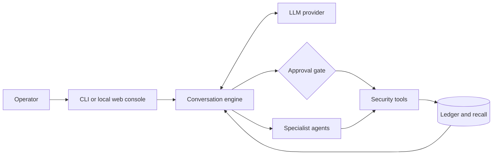

<p align="center">
  <picture>
    <source media="(prefers-color-scheme: dark)" srcset="docs/assets/kerkov-readme-dark.png">
    <source media="(prefers-color-scheme: light)" srcset="docs/assets/kerkov-readme-light.png">
    
  </picture>
</p>

<h1 align="center">Kerkov</h1>

<p align="center">
  <strong>Open-source AI for penetration testing, security research, and CTFs.</strong>
</p>

<p align="center">
  Plan, execute, and document penetration tests from one conversational interface—with the model, tools, and level of human control you choose.
</p>

<p align="center">
  <a href="https://github.com/Kerkov-Security/kerkov/actions/workflows/unit-tests.yml"></a>
  
  <a href="LICENSE"></a>
  
  <a href="https://github.com/Kerkov-Security/kerkov/stargazers"></a>
</p>

<p align="center">
  <a href="#quick-start">Quick start</a> ·
  <a href="#run-with-docker-compose">Container</a> ·
  <a href="#what-kerkov-can-do">Features</a> ·
  <a href="#operational-modes">Modes</a> ·
  <a href="#toolkit">Toolkit</a> ·
  <a href="#how-it-works">Architecture</a>
</p>

> [!IMPORTANT]
> Kerkov can execute commands and perform active security testing. Use it only on systems you own or have explicit permission to test, and keep every action inside the agreed scope.

## Overview

Kerkov is an open-source, security-focused conversational AI that works alongside you in the terminal. It can inspect code, operate a browser, run and supervise processes, call security services, look up current vulnerability intelligence, and coordinate specialist agents—all while preserving the engagement context for later recall.

It is designed for security practitioners who want the speed of an AI agent without giving up visibility or control. Tool calls pass through configurable approval rules, secrets are collected outside the chat, and intrusive scanners stay behind explicit authorization boundaries by default.

## What Kerkov can do

| | |
| --- | --- |
| **⚡ Act, not just advise**<br>Run commands, edit files, drive browsers, make HTTP requests, and monitor long-running processes from the conversation. | **🧠 Coordinate specialist agents**<br>Delegate recon, analysis, exploitation, or container operations while the main conversation stays focused. |
| **🛡️ Keep the operator in control**<br>Choose strict, normal, permissive, or fully autonomous approval gating independently from narration verbosity. | **🔌 Use the model you prefer**<br>Switch between Anthropic, Gemini, NVIDIA NIM, OpenRouter, Ollama, and Codex without changing the workflow. |
| **🎯 Work in the right posture**<br>Move between Recon, Audit, Offensive, and CTF modes, each with its own methodology and boundaries. | **📚 Remember the engagement**<br>Resume saved conversations, record verified findings in a ledger, and recall bulky tool output from a local SQLite knowledge base. |

### Built for

- Authorized application and infrastructure assessments
- Security reviews with controlled proof-of-concept validation
- Reconnaissance and attack-surface mapping
- CTF, lab, and vulnerability-research workflows
- Repeatable security automation from a CLI or CI job

## Quick start

### Prerequisites

- [uv](https://docs.astral.sh/uv/) and Python 3.10+
- An account or local endpoint for one [supported model provider](#model-providers)
- Docker with a running daemon only if you want Kerkov to manage OWASP ZAP
- Docker with the Compose plugin if you want to run Kerkov in containers
- Syft or Grype on `PATH` if you want SBOM generation or vulnerability scanning

### One-line install (Linux and macOS)

Once the first tagged release is published, install the latest release without
cloning the repository or setting up Python:

```bash
curl -fsSL https://raw.githubusercontent.com/Kerkov-Security/kerkov/main/install.sh | bash
kerkov
```

The installer supports x86_64 and arm64. It visibly installs
[uv](https://docs.astral.sh/uv/) if needed, provisions Python 3.13 when missing,
and installs the versioned wheel from GitHub Releases into an isolated uv tool
environment. Commands go in `~/.kerkov/bin`; `INSTALL_DIR` can select a different
absolute executable directory. Shell setup covers bash, zsh, fish, and sh/ash
login profiles, plus `GITHUB_PATH` in CI. Open a new terminal or run the PATH
command printed by the installer before launching Kerkov in your current shell.

Pin a release, include the optional web console, or opt into the Chromium download:

```bash
curl -fsSL https://raw.githubusercontent.com/Kerkov-Security/kerkov/main/install.sh | VERSION=0.1.0 bash
curl -fsSL https://raw.githubusercontent.com/Kerkov-Security/kerkov/main/install.sh | bash -s -- --web --chromium
# Unattended install; no browser download or shell startup edits
curl -fsSL https://raw.githubusercontent.com/Kerkov-Security/kerkov/main/install.sh | bash -s -- --no-chromium --no-modify-path
```

Chromium is a large optional download. Interactive installs ask on the terminal;
CI and unattended installs skip the prompt. Missing browser libraries and host
tools are informational and include browser remediation commands for the exact
installed Python environment. Docker is only needed for features that use it.

The installer seeds missing skills, agent profiles, `config/http_profiles.yaml`,
and `approvals.yaml` under `~/.kerkov/`, preserving all existing files. Checkout
installs use repository assets; installed wheels use user assets when present,
otherwise bundled defaults. `HTTP_PROFILES_PATH` remains an explicit override.

Re-run the installer to upgrade (include `--web` to keep the web extra). Repeating
the same release and extras is a no-op for uv. Older commands elsewhere on PATH
are reported with their package-manager cleanup commands; existing installations
are not deleted. Uninstall with `uv tool uninstall kerkov`. Credentials,
engagements, and customizations under `~/.kerkov/` remain available. You can remove
the lines marked `# Kerkov installer` from your shell startup files afterward.

### Manual install and Windows

Download the universal wheel from [GitHub Releases](https://github.com/Kerkov-Security/kerkov/releases).
With a compatible Python (3.10–3.14) in an activated virtual environment, install it:

```bash
python -m pip install /path/to/kerkov-0.1.0-py3-none-any.whl
kerkov --version
kerkov
```

Use the actual wheel filename for the selected release; Windows users can use the
same commands with their downloaded wheel path. PyPI publication is not configured.

### Run from source

```bash
git clone https://github.com/Kerkov-Security/kerkov.git
cd kerkov
uv sync --locked
uv run kerkov
```

On first use, choose a provider and follow the masked credential prompt. Kerkov validates the credential before saving it to your operating-system keyring. On headless systems without a keyring, it can fall back to a user-only file under `~/.kerkov/`.

No `.env` file is required for ordinary interactive use.

### Install directly from GitHub

Before the first release, or to try unreleased changes, install the current main branch as a uv tool:

```bash
uv tool install --python 3.13 git+https://github.com/Kerkov-Security/kerkov.git
kerkov
```

### Run with Docker Compose

Build the local image, generate a ZAP API key, and start the hardened Kerkov
and ZAP stack:

```bash
docker buildx build --load --file image/Dockerfile --tag kerkov:local .
export ZAP_API_KEY="$(openssl rand -hex 32)"
KERKOV_IMAGE=kerkov:local docker compose run --rm --service-ports kerkov
docker compose down
```

Kerkov runs as a non-root user with a read-only root filesystem. Runtime state
is stored in the `kerkov-state` volume, while `./workspace` is mounted at
`/workspace`. The ZAP API remains internal to the Compose network.

## Optional OpenGrep SAST

The `sast_scan` tool uses the LGPL-2.1-licensed OpenGrep engine locally and does
not require a paid account or API. Kerkov uses a working `opengrep` from
`PATH` when available. To explicitly install the latest stable self-contained
binary from the official GitHub release, run:

```bash
kerkov setup opengrep
```

The setup command checks the downloaded bytes against the SHA-256 digest in
GitHub's release metadata and installs the binary under
`~/.kerkov/tools/opengrep/` without requiring `sudo`. This detects transfer
corruption or mismatch; it does not establish provenance independently of
GitHub or the OpenGrep release account. Scans never download or install
software; if OpenGrep is missing, `sast_scan` reports the setup command and
stops before creating artifacts.

You can still install OpenGrep yourself and verify it normally:

```bash
opengrep --version
```

Scans accept explicit host-local source targets and local OpenGrep/Semgrep rule
files. Absolute paths are supported; relative paths remain confined to the
engagement workspace. Configuration discovery is opt-in because a discovered
file controls scan policy and should only be used for a reviewed source tree.
The complete JSON report and console log are retained under the engagement
workspace's `artifacts/sast/` directory, while the model receives a redacted,
bounded finding summary. The `timeout_seconds` budget covers scanning and
bounded report processing.

## A first engagement

Start in the default Audit mode and describe the authorized target and objective:

```text
$ uv run kerkov

kerkov › Review this local application for authentication and access-control flaws.
         Do not test anything outside http://127.0.0.1:3000.
```

Useful launch patterns:

```bash
# Passive discovery and enumeration
uv run kerkov --mode recon

# Resume the most recent saved engagement
uv run kerkov --continue

# Resume a specific engagement
uv run kerkov --resume <engagement-id>

# Process one or more messages without the interactive UI
uv run kerkov --message "Summarize the security boundaries in this repository" --no-welcome
```

> [!CAUTION]
> Non-interactive runs auto-approve tool calls. Use them only in an isolated environment with a tightly scoped prompt and target.

Inside the CLI, `/help` shows the complete command reference. Common commands include:

| Command | Purpose |
| --- | --- |
| `/mode [recon\|audit\|offensive\|ctf]` | Show or change the operational posture |
| `/provider [name]` · `/model [name]` | Change the active provider or model |
| `/autonomy [1-4]` | Set narration and approval behavior together |
| `/approval [strict\|normal\|permissive\|yolo]` | Change approval gating only |
| `/engagements` · `/resume [id]` | List and restore saved work |
| `/auth` · `/logout` | Manage credentials without exposing secret values in chat |
| `/zap status` · `/zap stop` | Inspect or stop Kerkov's managed ZAP runtime |

## Operational modes

| Mode | Best for | Behavior |
| --- | --- | --- |
| **Recon** | Discovery and attack-surface mapping | Passive-first enumeration and analysis; no exploitation |
| **Audit** | Professional penetration tests | Methodical testing, controlled validation, evidence, and remediation guidance |
| **Offensive** | Red-team exercises | Objective-driven exploitation, chaining, and deeper attack-path analysis |
| **CTF** | Competitions and training labs | Fast hypothesis testing, scripting, and flag extraction |

`audit` is the default. Launch directly into Recon, Audit, or Offensive mode with `--mode`; switch to any mode, including CTF, with `/mode` during a session.

## Toolkit

Kerkov exposes a focused set of tools to the active model and applies the current approval policy before execution.

| Area | Capabilities |
| --- | --- |
| **System** | One-shot and persistent shell execution, process supervision, file reads, and file writes |
| **Web** | Authenticated HTTP profiles, Playwright browser automation, screenshots, and optional Tavily or SearXNG search |
| **Security** | CVE data merged from NVD, CISA KEV, and EPSS; Syft SBOM generation; Grype vulnerability scanning; managed OWASP ZAP spidering and active scans |
| **Operations** | Docker Compose lifecycle management with readiness checks and full logs stored as artifacts |
| **Knowledge** | Skills, a findings ledger, full-text recall, resumable engagements, and shared agent workspaces |
| **Agents** | Detached specialist agents with scoped tools, shared workspaces, and structured reports |

Install Chromium once if you plan to use the browser tool:

```bash
uv run python -m playwright install chromium
```

### Managed OWASP ZAP

There is no separate ZAP setup command. On the first approved spider or active scan, Kerkov can:

1. Pull the official stable ZAP image.
2. Generate a random API key.
3. Start a labeled container with its API published on an available loopback port.
4. Wait for a successful health probe before saving any runtime state.

The forward proxy is not published, the API key is not exposed in Docker arguments or normal logs, and `/zap stop` only removes a container carrying Kerkov's managed label. See the [tool documentation](docs/tools/tools-overview.md#owasp-zap-tool) for target routing and external-service configuration.

## Model providers

| Provider | Authentication |
| --- | --- |
| **Anthropic** | API key |
| **Google Gemini** | API key |
| **NVIDIA NIM** | API key |
| **OpenRouter** | API key |
| **Ollama** | Local server URL; no key required by default |
| **Codex** | Browser-based sign-in |

Use `/provider` and `/model` to switch at runtime. API keys are entered in a separate masked prompt so they never become part of the conversation history or normal logs. Environment variables remain available for CI and other non-interactive environments; copy `.env.example` to `.env` only when you need those overrides.

## Human control by design

Approval gating and action narration are independent. You can keep terse output with strict confirmations, or detailed narration with a more permissive policy.

| Approval mode | Behavior |
| --- | --- |
| **Strict** | Deny rules apply; every other tool call asks first |
| **Normal** | Allow and deny rules apply; unmatched calls ask first |
| **Permissive** | Deny rules apply; every other call is approved |
| **YOLO** | Bypasses all prompts and rules; requires `ALLOW_AUTONOMOUS=true` |

Normal mode is the default. Project, user, and engagement-specific YAML rules let you make safe repetitive work frictionless without globally relaxing the policy. Read the [approval-system guide](docs/tools/tool-approval.md) for rule syntax and precedence.

## How it works



The CLI and experimental web console share the same conversation engine. The engine gives each provider a normalized tool interface, routes calls through the approval layer, and writes engagement history locally. Delegated agents receive isolated conversations and restricted tool sets, while sharing the root engagement's workspace and knowledge base.

For a deeper walkthrough, see the [project overview](docs/PROJECT_OVERVIEW.md), [agent subsystem](docs/agent-subsystem.md), and [tool overview](docs/tools/tools-overview.md).

## Experimental web console

The local web console exposes the same runtime through Django, Channels, and WebSockets:

```bash
uv sync --locked --extra web
uv run --no-sync kerkov-web runserver
```

Open `http://127.0.0.1:8764/`.

> [!WARNING]
> The web console is an alpha preview with no user authentication. It intentionally accepts loopback hosts only; do not publish it to a LAN, tunnel, or reverse proxy.

## Development

Set up the complete development environment and run the checks used by CI:

```bash
uv sync --locked --extra dev --extra test --extra web
uv run python -m flake8 --select=E301,E302,E303,E305,E306 src tests
uv run python -m pytest tests
```

When dependencies change, update `pyproject.toml`, run `uv lock`, and verify with the locked sync command above.

To validate distributable assets and the installer, run:

```bash
uv build
uv run --no-sync python .github/scripts/package-smoke.py dist/*.whl
uv run --no-sync python -m pytest tests/install
```

The build copies repository-maintained skills, companion scripts, agent profiles,
and HTTP defaults into the wheel, including when built from the source distribution.
The smoke test uses a temporary home and an unrelated working directory, tests a
CLI-only install, then adds the web extra. CI runs it on Linux and macOS.

To check the complete bootstrap on a fresh Ubuntu system, open **Actions →
Installer and wheel → Run workflow**, select the branch, and optionally enable
the web console. You can also trigger it from the CLI:

```bash
gh workflow run installer.yml --repo Kerkov-Security/kerkov --ref main
# Include the web console:
gh workflow run installer.yml --repo Kerkov-Security/kerkov --ref main -f web=true
```

The **Install on fresh Ubuntu 24.04** job runs only on manual dispatch. It uses a
new Ubuntu container on a GitHub-hosted runner, creates a regular user, and
confirms that uv, Python, pip, and Kerkov are absent. It runs the real installer
using the wheel built from the selected branch, so no published release is
needed. The installer downloads uv and Python itself. The job checks login-shell
PATH, `kerkov --version`/`--help`, bundled skills and config, and a repeat install
that preserves user edits. Its summary reports the result; the
**ubuntu-installer-log** artifact contains the full output. Chromium is skipped.

For this development test, `KERKOV_WHEEL_URL` selects an HTTPS or absolute file
URL for a built wheel and requires an explicit `VERSION`. Normal installs still
resolve their wheel from GitHub Releases. Replace `main` in the commands above
with the branch you want to test. If the Actions page does not yet show **Run
workflow**, use the CLI command to trigger the registered workflow on that branch.

Maintainers publish a stable release by updating `project.version`, refreshing
`uv.lock`, and pushing a matching `vX.Y.Z` tag. The release workflow verifies the
tag, runs tests and the installed-wheel smoke test, then publishes the wheel,
source archive, installer, and `SHA256SUMS` to GitHub Releases. No PyPI secret or
custom install domain is needed. The one-line installer becomes usable after
this code is on `main` and the first matching release is published.

Issues and pull requests are welcome. Please include a clear scope, reproduction steps for bugs, and tests for behavior changes where practical.

## Project status

Kerkov is alpha software. Interfaces, configuration, and stored data formats may change before the stable release. The CLI is the primary experience; the web console is experimental.

## Responsible use

Kerkov is built for legitimate security assessment, research, and education. It does not grant permission to test a target. You are responsible for obtaining authorization, defining scope, protecting collected data, and following applicable laws and engagement rules.

Only test systems you own or are explicitly authorized to assess.
